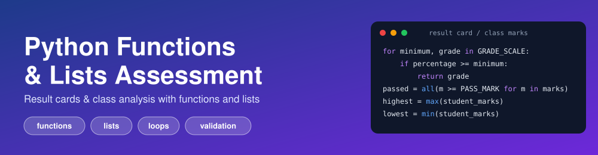
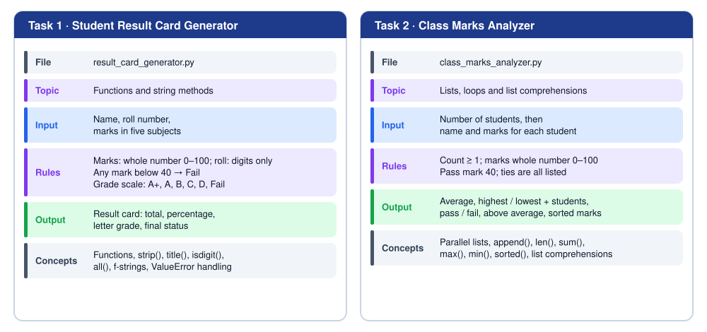
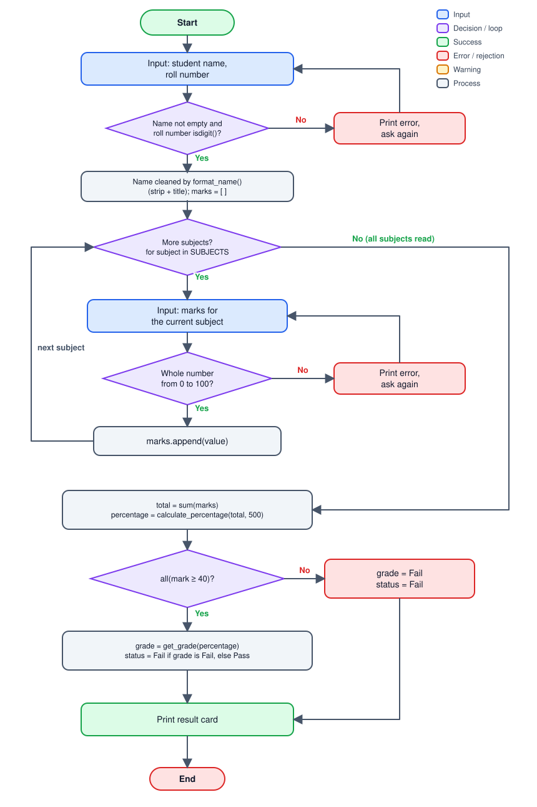
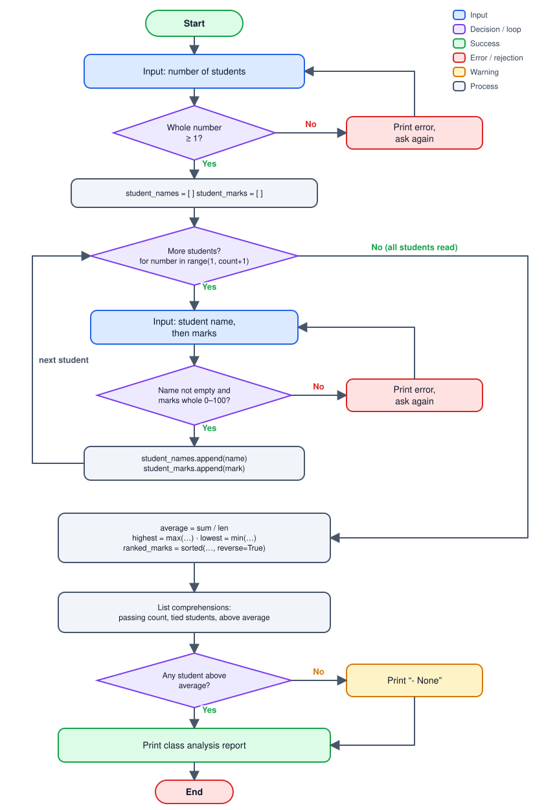
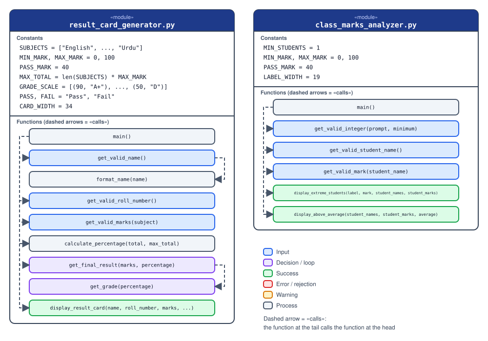

<p align="center"></p>

## 1. Project Overview

Two Python programs that practise functions, string methods, lists, loops and input validation. No external packages are needed.

| Task | File | Topic |
|------|------|-------|
| 1 | `result_card_generator.py` | Functions, string methods (`strip()`, `title()`, `isdigit()`), `all()`, f-strings |
| 2 | `class_marks_analyzer.py` | Parallel lists, `append()`, `len()` / `sum()` / `max()` / `min()` / `sorted()`, list comprehensions |

<p align="center"></p>

## 2. Folder Structure

```text
python-functions-lists-assessment/
├── assets/
│   ├── banner.svg
│   ├── class_marks_flow.svg
│   ├── overview.svg
│   ├── result_card_flow.svg
│   └── uml_diagram.svg
├── class_marks_analyzer.py
├── README.md
└── result_card_generator.py
```

`assets/` holds only the README images. The two `.py` files and `README.md` match the structure required by the brief.

## 3. Task 1: Student Result Card Generator

**Summary.** `result_card_generator.py` asks for one student's name, roll number and marks in five subjects (English, Mathematics, Computer, Physics, Urdu). It validates the roll number and marks, calculates the total and percentage, assigns a grade and prints a formatted result card.

**Rules**

- Roll number: digits only.
- Each mark: a whole number from 0 to 100.
- Total is out of 500; percentage is total / 500 x 100.
- Grade scale: 90 and above = A+, 80 to 89.99 = A, 70 to 79.99 = B, 60 to 69.99 = C, 50 to 59.99 = D, below 50 = Fail.
- **Result rule:** if any subject mark is below 40, the letter grade and final status are both `Fail`, even when the percentage is high.

### Program Flow

<p align="center"></p>

### Code Methods Description

| Method / section | Purpose |
|------------------|---------|
| Constants (`SUBJECTS`, `MIN_MARK`, `MAX_MARK`, `PASS_MARK`, `MAX_TOTAL`, `GRADE_SCALE`, `PASS`, `FAIL`, `CARD_WIDTH`) | Keep subjects, limits and the grading scale in one place |
| `format_name(name)` | Uses `strip()` and `title()` to clean the name |
| `get_valid_name()` | Repeats the prompt until the cleaned name is not empty |
| `get_valid_roll_number()` | Uses `isdigit()` to accept digits only |
| `get_valid_marks(subject)` | Validates a whole number from 0 to 100 for one subject |
| `calculate_percentage(total, max_total)` | Returns the overall percentage |
| `get_grade(percentage)` | Returns the letter grade from `GRADE_SCALE` |
| `get_final_result(marks, percentage)` | Uses `all()` to check every mark is at least 40; returns `(grade, status)` |
| `display_result_card(name, roll_number, marks, total, percentage, grade, status)` | Prints the card with f-strings |
| `main()` | Coordinates input, calculation and result-card display |

### Input Validation

- Name: cannot be empty after `strip()`.
- Roll number: `isdigit()` rejects letters, spaces, symbols and negative signs; leading zeros are kept (`007`).
- Marks: `ValueError` is caught for text and decimals such as `abc` or `85.5`; values outside 0 to 100 are rejected. Every error repeats the prompt.
- If input ends early (EOF), the program prints a clear error and exits without a crash.

### Expected Results

- The brief's sample (`aLI raza`, 1025, 85 / 92 / 88 / 79 / 90) gives 434 / 500, 86.80%, grade A, Pass.
- Grade boundaries (90, 80, 70, 60, 50 percent) move up exactly at the limit.
- A mark of exactly 40 passes; a mark of 39 gives Fail / Fail even at 87.80%.
- The card lists every subject that is below 40.

## 4. Task 2: Class Marks Analyzer

**Summary.** `class_marks_analyzer.py` collects each student's name and marks in two parallel lists (`student_names`, `student_marks`), then prints the class analysis.

**Rules**

- Number of students: a whole number of at least 1.
- Each mark: a whole number from 0 to 100.
- A student passes with 40 or more marks.
- Every student tied on the highest or lowest mark is listed.
- Students above the class average and the marks sorted from highest to lowest are shown.

### Program Flow

<p align="center"></p>

### Code Methods Description

| Method / section | Purpose |
|------------------|---------|
| Constants (`MIN_STUDENTS`, `MIN_MARK`, `MAX_MARK`, `PASS_MARK`, `LABEL_WIDTH`) | Limits, pass mark and report alignment |
| `get_valid_integer(prompt, minimum)` | Validates the number of students (whole number, at least `minimum`) |
| `get_valid_student_name()` | Repeats the prompt until the name is not empty |
| `get_valid_mark(student_name)` | Validates a whole number from 0 to 100 for one student |
| `display_extreme_students(label, mark, student_names, student_marks)` | Prints the highest or lowest mark and all tied students (list comprehension) |
| `display_above_average(student_names, student_marks, average)` | Selects students above average with a list comprehension and prints them in a loop |
| `main()` | `for` loop with `.append()` collects data; `len()`, `sum()`, `max()`, `min()`, `sorted()` and a list comprehension (pass count) build the report |

### Input Validation

- Number of students: `ValueError` is caught for text and decimals; values below 1 are rejected.
- Name: cannot be empty.
- Marks: `ValueError` is caught for text and decimals; values outside 0 to 100 are rejected. Every error repeats the prompt.
- If input ends early (EOF), the program prints a clear error and exits without a crash.

### Expected Results

- The brief's sample (Ayesha 90, Bilal 75, Hina 90, Usman 35) gives average 72.50, tied highest Ayesha and Hina, 3 passing and 1 failing.
- When every student has the same mark, all are listed as highest and lowest, and "- None" is shown above average.
- A mark of 40 passes and 39 fails.
- Marks are shown sorted high to low, with duplicates kept.

## 5. UML Diagram

I chose a **module diagram** because both programs are procedural (no classes): it shows each file's constants and functions, and the `«calls»` arrows show which function calls which. (`display_result_card` is shortened in the diagram; its full signature is in the table above.)

<p align="center"></p>

## 6. Concepts and Techniques Used

- Functions with parameters and return values (including returning a tuple)
- String methods: `strip()`, `title()`, `isdigit()`, `isascii()`, `capitalize()`, `join()`
- `try` / `except ValueError` and `EOFError` for input handling
- `while True` loops for validation, `for` loops with `range()` and `zip()`
- Lists: `student_names` and `student_marks`, `.append()`
- `len()`, `sum()`, `max()`, `min()`, `sorted()` and `all()`
- List comprehensions for failed subjects, passing students, tied students and above-average students
- f-strings with alignment and number formatting (`:<12`, `:.2f`)
- Constants instead of magic numbers

## 7. How to Run

**Requirements**

- Python 3.8 or later
- No external packages

**Clone and open the project**

```bash
git clone https://github.com/aliraza019013-droid/python-functions-lists-assessment.git
cd python-functions-lists-assessment
```

**Run Task 1**

```bash
python result_card_generator.py
```

**Run Task 2**

```bash
python class_marks_analyzer.py
```

**Alternative commands:** use `python3 result_card_generator.py` (macOS / Linux) or `py result_card_generator.py` (Windows launcher), and the same pattern for `class_marks_analyzer.py`.

## 8. Sample Execution

All outputs below were produced by running the real programs.

### Task 1

**Success: sample from the brief**

```text
=== Student Result Card Generator ===
Student name:   aLI raza
Roll number: 1025
English: 85
Mathematics: 92
Computer: 88
Physics: 79
Urdu: 90

==================================
           RESULT CARD
==================================
Student Name : Ali Raza
Roll Number  : 1025
----------------------------------
English      : 85
Mathematics  : 92
Computer     : 88
Physics      : 79
Urdu         : 90
----------------------------------
Total Obtained: 434 / 500
Percentage   : 86.80%
Letter Grade : A
Final Status : Pass
==================================
```

**Failure: one mark below 40 despite 87.80%**

```text
=== Student Result Card Generator ===
Student name: Omar
Roll number: 3
English: 39
Mathematics: 100
Computer: 100
Physics: 100
Urdu: 100

==================================
           RESULT CARD
==================================
Student Name : Omar
Roll Number  : 3
----------------------------------
English      : 39
Mathematics  : 100
Computer     : 100
Physics      : 100
Urdu         : 100
Failed In    : English (39)
----------------------------------
Total Obtained: 439 / 500
Percentage   : 87.80%
Letter Grade : Fail
Final Status : Fail
==================================
```

**Edge case: invalid inputs, then valid ones**

```text
=== Student Result Card Generator ===
Student name: 
Error: Name cannot be empty. Please try again.
Student name:   
Error: Name cannot be empty. Please try again.
Student name: Ali Raza
Roll number: 10a5
Error: Roll number must contain digits only (no letters, spaces or symbols).
Roll number: 
Error: Roll number must contain digits only (no letters, spaces or symbols).
Roll number: -12
Error: Roll number must contain digits only (no letters, spaces or symbols).
Roll number: 12 5
Error: Roll number must contain digits only (no letters, spaces or symbols).
Roll number: 007
English: abc
Error: Marks for English must be a whole number.
English: 85.5
Error: Marks for English must be a whole number.
English: 101
Error: Marks for English must be between 0 and 100.
English: -1
Error: Marks for English must be between 0 and 100.
English: 
Error: Marks for English must be a whole number.
English: 85
Mathematics: 1_0
Error: Marks for Mathematics must be a whole number.
Mathematics: 92
Computer: 88
Physics: 79
Urdu: 90

==================================
           RESULT CARD
==================================
Student Name : Ali Raza
Roll Number  : 007
----------------------------------
English      : 85
Mathematics  : 92
Computer     : 88
Physics      : 79
Urdu         : 90
----------------------------------
Total Obtained: 434 / 500
Percentage   : 86.80%
Letter Grade : A
Final Status : Pass
==================================
```

### Task 2

**Success: sample from the brief**

```text
=== Class Marks Analyzer ===
How many students are in the class? 4

Student 1
Name: Ayesha
Marks: 90

Student 2
Name: Bilal
Marks: 75

Student 3
Name: Hina
Marks: 90

Student 4
Name: Usman
Marks: 35

--- Class Analysis ---
Number of students : 4
Class average      : 72.50
Highest marks      : 90
Student(s) with highest marks: Ayesha, Hina
Lowest marks       : 35
Student(s) with lowest marks: Usman
Passing students   : 3
Failing students   : 1
Students above class average:
- Ayesha (90)
- Bilal (75)
- Hina (90)
Marks (highest to lowest): [90, 90, 75, 35]
```

**Edge case: every student tied on the same mark**

```text
=== Class Marks Analyzer ===
How many students are in the class? 3

Student 1
Name: A
Marks: 80

Student 2
Name: B
Marks: 80

Student 3
Name: C
Marks: 80

--- Class Analysis ---
Number of students : 3
Class average      : 80.00
Highest marks      : 80
Student(s) with highest marks: A, B, C
Lowest marks       : 80
Student(s) with lowest marks: A, B, C
Passing students   : 3
Failing students   : 0
Students above class average:
- None
Marks (highest to lowest): [80, 80, 80]
```

**Edge case: invalid inputs, then valid ones**

```text
=== Class Marks Analyzer ===
How many students are in the class? 0
Error: Value must be at least 1.
How many students are in the class? abc
Error: Please enter a whole number.
How many students are in the class? -2
Error: Value must be at least 1.
How many students are in the class? 2.5
Error: Please enter a whole number.
How many students are in the class? 
Error: Please enter a whole number.
How many students are in the class? 2

Student 1
Name: 
Error: Name cannot be empty. Please try again.
Name: Ali
Marks: x
Error: Marks for Ali must be a whole number.
Marks: 101
Error: Marks for Ali must be between 0 and 100.
Marks: -1
Error: Marks for Ali must be between 0 and 100.
Marks: 85.5
Error: Marks for Ali must be a whole number.
Marks: 1_0
Error: Marks for Ali must be a whole number.
Marks: 80

Student 2
Name: Sara
Marks: 60

--- Class Analysis ---
Number of students : 2
Class average      : 70.00
Highest marks      : 80
Student(s) with highest marks: Ali
Lowest marks       : 60
Student(s) with lowest marks: Sara
Passing students   : 2
Failing students   : 0
Students above class average:
- Ali (80)
Marks (highest to lowest): [80, 60]
```

## 9. Test Cases

Every case below was run against the real code and matched the expected result.

### Task 1: `result_card_generator.py`

| # | Scenario | Inputs | Expected result |
|---|----------|--------|-----------------|
| 1 | Sample from brief (name with extra spaces / odd case) | `  aLI raza, 1025, 85, 92, 88, 79, 90` | Ali Raza, 434 / 500, 86.80%, A, Pass |
| 2 | Boundary 90.00%: total 450 | `A, 1, 90, 90, 90, 90, 90` | A+, Pass |
| 3 | Boundary 89.80%: total 449 | `A, 1, 90, 90, 90, 90, 89` | A, Pass |
| 4 | Boundary 80.00%: total 400 | `A, 1, 80, 80, 80, 80, 80` | A, Pass |
| 5 | Boundary 79.80%: total 399 | `A, 1, 80, 80, 80, 80, 79` | B, Pass |
| 6 | Boundary 70.00%: total 350 | `A, 1, 70, 70, 70, 70, 70` | B, Pass |
| 7 | Boundary 69.80%: total 349 | `A, 1, 70, 70, 70, 70, 69` | C, Pass |
| 8 | Boundary 60.00%: total 300 | `A, 1, 60, 60, 60, 60, 60` | C, Pass |
| 9 | Boundary 59.80%: total 299 | `A, 1, 60, 60, 60, 60, 59` | D, Pass |
| 10 | Boundary 50.00%: total 250 | `A, 1, 50, 50, 50, 50, 50` | D, Pass |
| 11 | Boundary 49.80%: total 249 (all marks >= 40) | `A, 1, 50, 50, 50, 50, 49` | Fail grade, Fail status |
| 12 | One mark exactly 40 (still passes) | `Sara, 2, 40, 100, 100, 100, 100` | 88.00%, A, Pass |
| 13 | One mark 39, high percentage (rule failing alone) | `Omar, 3, 39, 100, 100, 100, 100` | 87.80% but Fail / Fail |
| 14 | Several marks below 40 | `Hina, 4, 30, 35, 100, 100, 100` | Fail, both subjects listed |
| 15 | All marks 0 | `Zed, 5, 0, 0, 0, 0, 0` | 0.00%, Fail |
| 16 | All marks 100 | `Top, 6, 100, 100, 100, 100, 100` | 100.00%, A+, Pass |
| 17 | Invalid inputs then valid (name, roll, marks) | `(blank), (spaces), Ali Raza, 10a5, (blank), -12, 12 5, 007, abc, 85.5, 101, -1, (blank), 85, 1_0, 92, 88, 79, 90` | Errors shown, then card with roll 007 |
| 18 | Input ends early (EOF) | `Ali, 1025, 85` | Clear error, no crash |

### Task 2: `class_marks_analyzer.py`

| # | Scenario | Inputs | Expected result |
|---|----------|--------|-----------------|
| 1 | Sample from brief | `4, Ayesha, 90, Bilal, 75, Hina, 90, Usman, 35` | Avg 72.50, tie on 90, 3 pass / 1 fail |
| 2 | Single student | `1, Ali, 67` | Avg 67.00, highest = lowest = Ali, nobody above average |
| 3 | All students tied on the same mark | `3, A, 80, B, 80, C, 80` | All tied on both extremes, none above average |
| 4 | Pass mark boundary: 40 passes, 39 fails | `2, Pass, 40, Fail, 39` | 1 pass, 1 fail |
| 5 | All students fail | `2, A, 10, B, 20` | 0 pass, 2 fail |
| 6 | Extreme marks 0 and 100 | `2, Low, 0, High, 100` | Avg 50.00, High above average |
| 7 | Average with decimals (0, 0, 100) | `3, A, 0, B, 0, C, 100` | Avg 33.33, only C above average |
| 8 | Unsorted marks with duplicates | `5, A, 50, B, 95, C, 20, D, 70, E, 70` | Sorted list [95, 70, 70, 50, 20] |
| 9 | Invalid inputs then valid (count, name, marks) | `0, abc, -2, 2.5, (blank), 2, (blank), Ali, x, 101, -1, 85.5, 1_0, 80, Sara, 60` | Errors shown, then analysis of 2 students |
| 10 | Input ends early (EOF) | `3, Ali, 80, Sara` | Clear error, no crash |

---

<p align="center"><b>Author:</b> Muhammad Ali Raza · <b>GitHub:</b> <a href="https://github.com/aliraza019013-droid/python-functions-lists-assessment">aliraza019013-droid/python-functions-lists-assessment</a></p>
